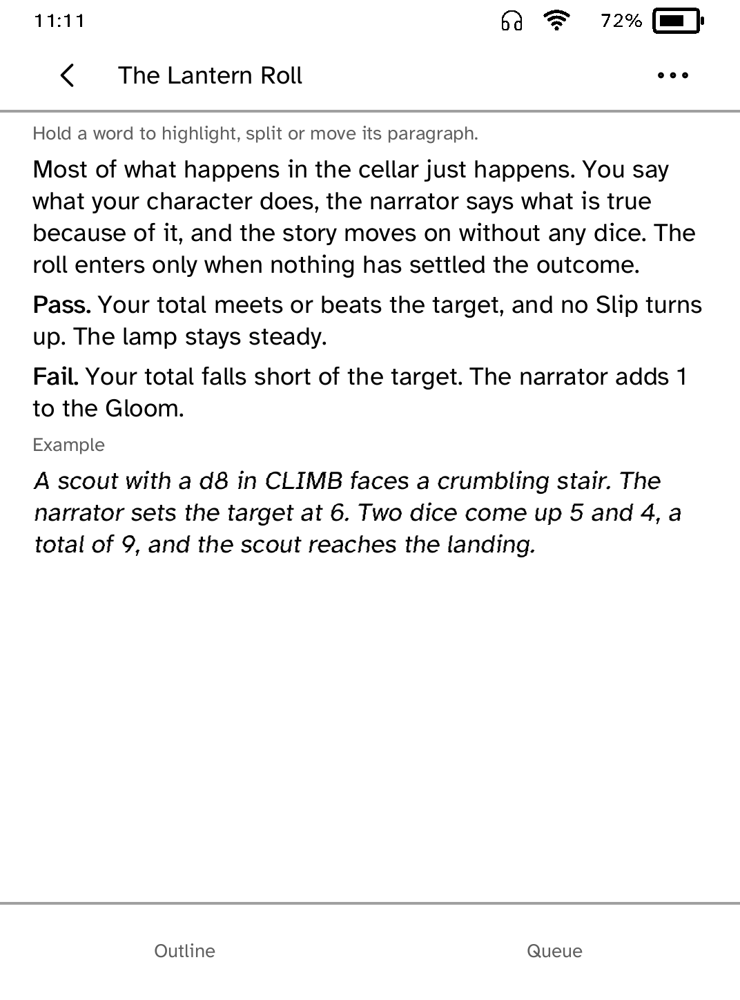
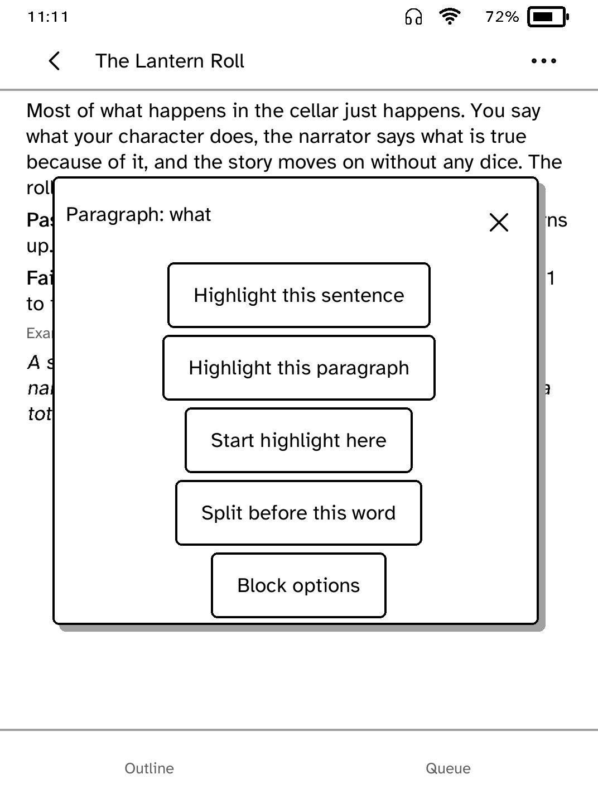
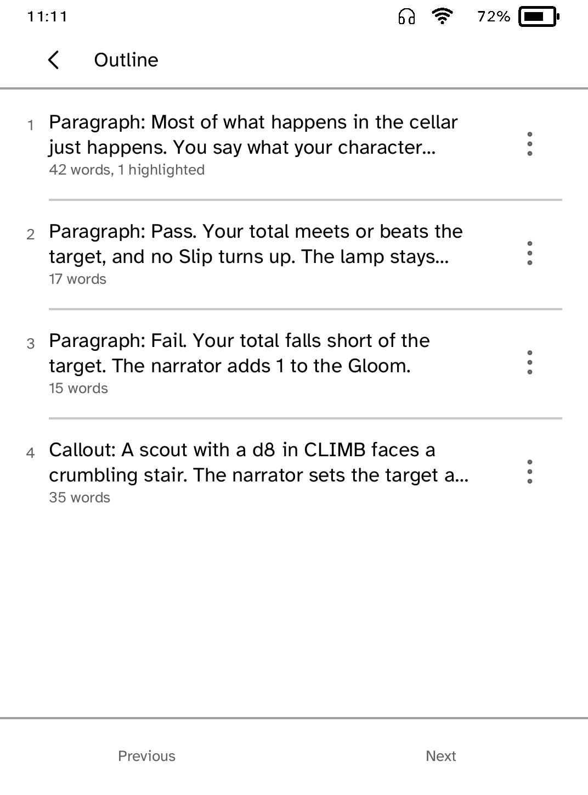
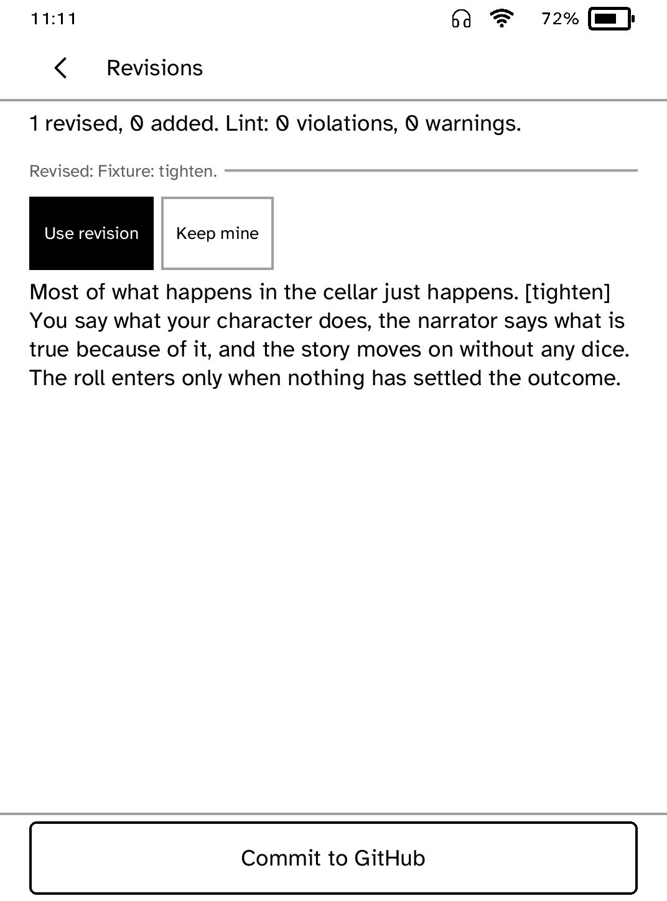

# Drafter

Mark up one section of a manuscript at a time on your Kobo, then send your
marks to a gateway you run. It revises the section under your book's own rules,
and you keep or discard each change before anything is committed to GitHub.

<table>
<tr>
<td width="50%" valign="top"><br>A section, one block per paragraph</td>
<td width="50%" valign="top"><br>The menu a held word opens</td>
</tr>
<tr>
<td width="50%" valign="top"><br>The outline, for moving blocks</td>
<td width="50%" valign="top"><br>A returned revision, ready to keep or discard</td>
</tr>
</table>

The screenshots use an invented sample book served by the gateway's test
fixture.

## Features

- Lists the sections of the current draft with their status.
- Draws paragraphs, callouts, tables and lists as separate blocks.
- Hold a word to highlight its sentence or paragraph, mark a range between two
  holds, split the paragraph before the word, or open that block's options.
- Each highlight asks for a kind of change (tighten, say it plainer, make it
  concrete, cut, keep, check) or carries your own note.
- The outline lists every block. Pick a block up from its row menu and tap where
  it goes (the start of the section or after another block). The same menu
  merges a paragraph up, retypes it, adds a note, writes a paragraph after it,
  asks for one to be written, or deletes the block.
- Queued changes survive a restart and are replayed against the section when it
  reopens.
- Send for revision, then read each change against the original and choose
  **Use revision** or **Keep mine**. Nothing is committed until you tap
  **Commit to GitHub**.
- A Locked section asks for confirmation before it is sent.

## Setup

Run the gateway (see `drafter/` in the companion repository) behind HTTPS with
a bearer token. It holds the GitHub and model credentials, so the reader never
does. Then, from your computer:

```sh
kobo drafter login --gateway <https-address> --token-file <path> --device <reader>
```

The token is checked against the gateway before it is installed, and it only
works with that gateway. The runtime attaches it, so it never appears in the
app's storage, URLs, requests or logs.

## Gateway API

All routes are under the gateway's base address and take the bearer token.
Domain outcomes (stale, rejected, duplicate) come back as `200` with a
`status`; `4xx` means the request itself was wrong.

- `GET /sections` returns the draft's sections with `id`, `file`, `chapter`,
  `title`, `status`, `blocks` and `words`.
- `GET /sections/{id}` returns `{id, title, file, rev, status, blocks}`. Blocks
  are `para`, `callout`, `table`, `list`, `code`, `marker` or `hr`, with text,
  spans, and (for tables) rows. `rev` is the version the section was read at.
- `POST /reviews` takes `{review_id, section_id, rev, ops}`. `ops` are `mark`,
  `note`, `want`, `move`, `split`, `merge`, `delete`, `edit` and `insert`.
  Offsets are UTF-8 bytes into a block's plain text. The device chooses ids for
  blocks it creates. `review_id` is a hash of the request and is the
  idempotency key. Returns a job id, or `stale` when `rev` is out of date.
- `GET /jobs/{id}` returns `{state, message, proposal}` where the proposal lists
  each block as `same`, `yours`, `revised` or `added`, with the reason, the
  original, lint results and flags.
- `POST /commits` takes `{review_id, decisions: [{block, take}]}` where `take`
  is `proposal` or `designer`, and returns `committed` with the commit.

`tests/golden.json` holds operation vectors that the gateway and the app both
replay; their results must match byte for byte.

## Limits

Only a bearer-token gateway reachable over HTTPS is supported. There is no
drag and drop: the touch SDK has no drag gesture, so blocks move by pick up and
place. Text is retyped through the on-screen keyboard from a block's row menu,
not inline.

## Permissions

- `network`: fetches sections and sends reviews and commits.

## Development

```sh
cargo test -p kobo-drafter
python3 scripts/quality/check-drafter-sim.py --gateway-src <gateway>/drafter \
    --output target/drafter-check
```

The simulator check serves the gateway's fixture book over TLS in-process,
drives the app with real taps and holds, and confirms the commit lands in a
repository clone.

## Credits

Drafter is an independent Cobalt app, licensed AGPL-3.0-only.
